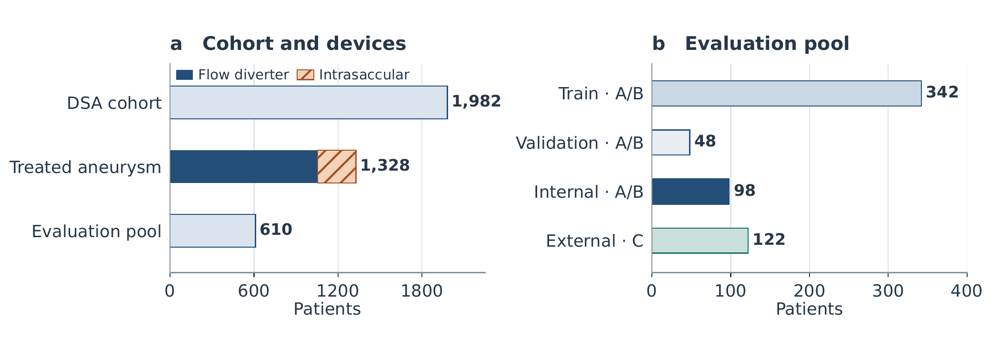
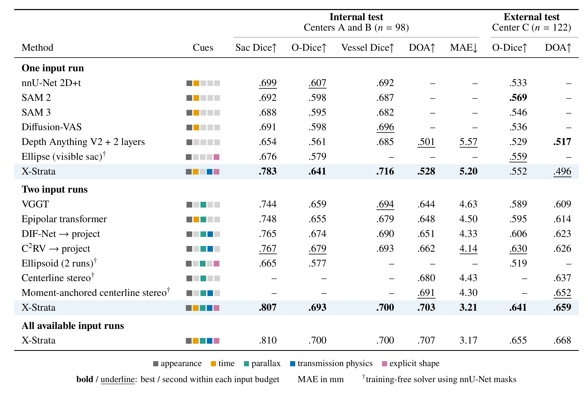
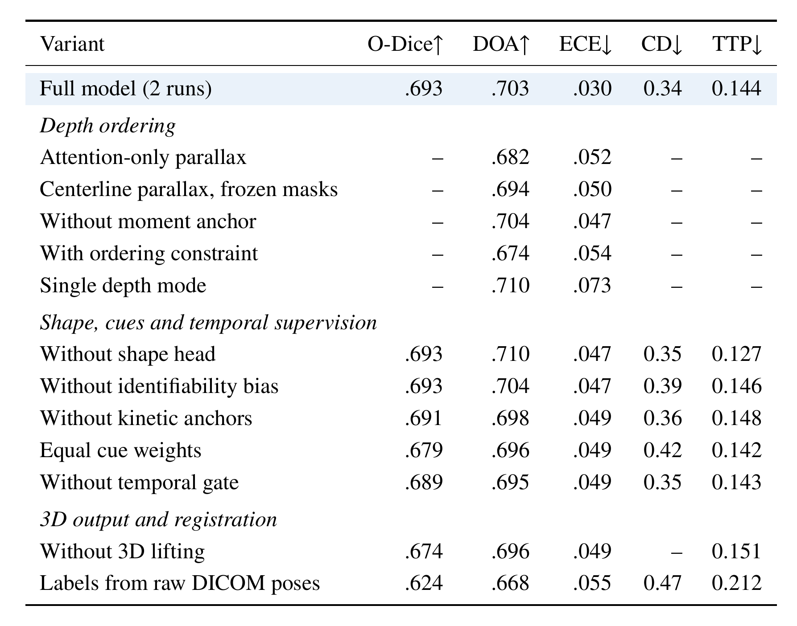
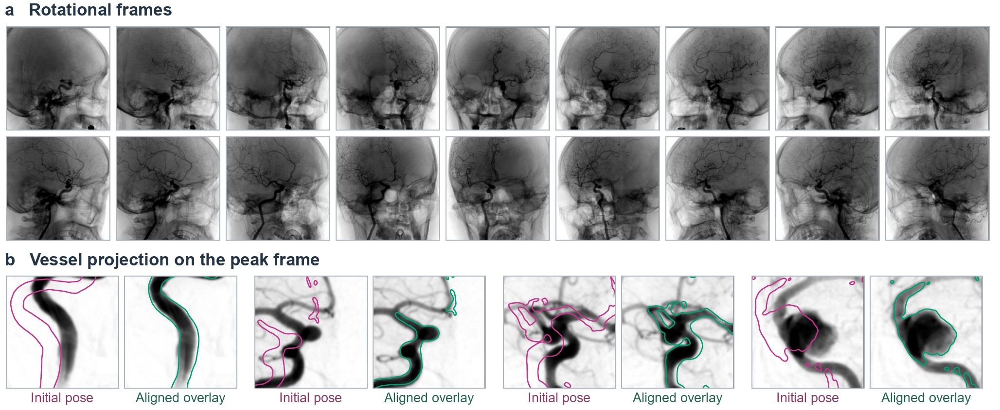
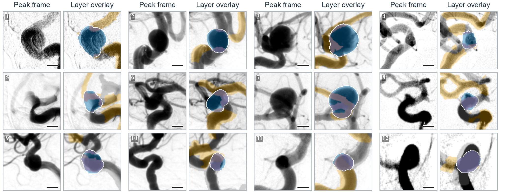
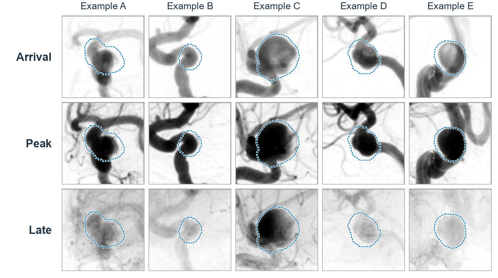
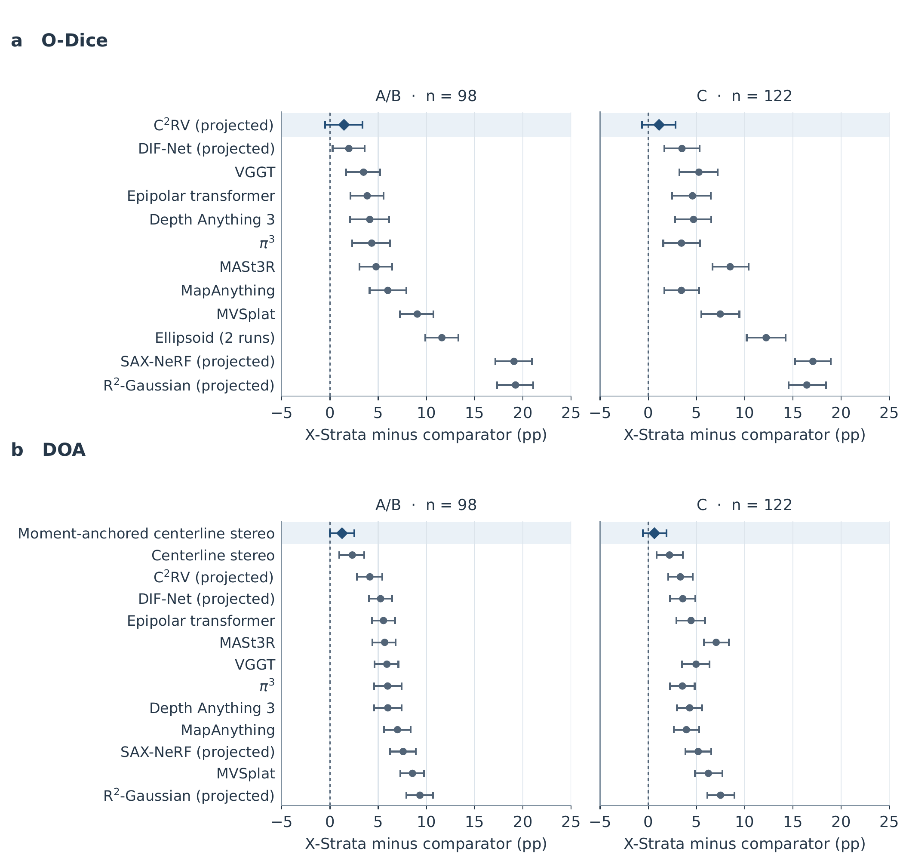
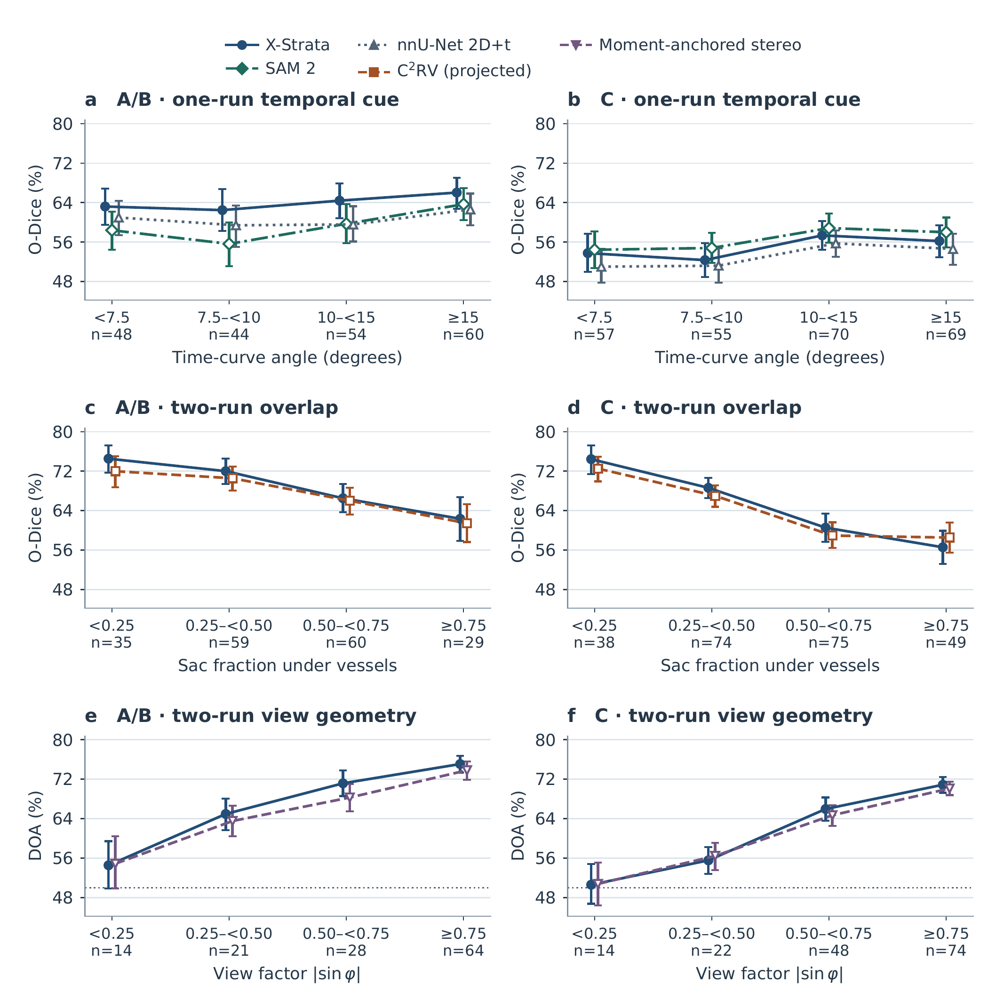
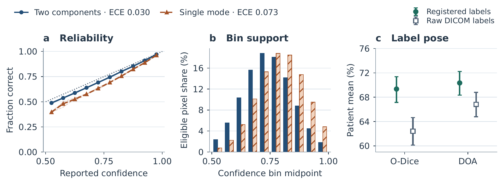
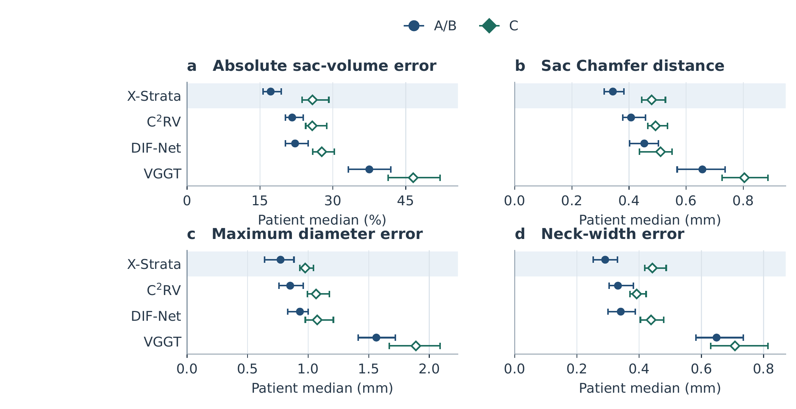

<div align="center">

# X-Strata

### Separating Aneurysms and Overlapping Vessels into Layers from 2D X-ray Angiography

[](#release-status)
[](#release-status)
[](#overview)
[](#data-and-evaluation)

<sub>digital subtraction angiography · intracranial aneurysm · amodal layers · depth order · contrast kinetics · 3D sac shape</sub>

[Overview](#overview) · [Analysis](#what-an-angiogram-reveals-about-layers) · [Method](#method) · [Data](#data-and-evaluation) · [Results](#results) · [Supplementary figures](#supplementary-figures) · [Limitations](#limitations) · [Status](#release-status)

</div>

<br>

<p align="center">
  
</p>

<p align="center"><sub><b>Layer separation in X-ray angiography.</b> Each log-subtracted pixel integrates contrast attenuation along a ray. Left: the C-arm acquisition setup. Center: sac–vessel overlap on a peak digital subtraction angiography frame. Right: the target layers, which comprise the amodal sac and the vessels in front of and behind it. Parallax between the two views provides a cue to their depth order.</sub></p>

## Highlights

- **Three layers from routine 2D angiography.** X-Strata separates a cine run into the complete (amodal) aneurysm sac, the vessels in front of it, and the vessels behind it, with a path length and a contrast curve for each layer.
- **Each cue for what it measures.** Contrast kinetics estimate how much each layer contributes to a pixel. Parallax between two views constrains the order of the layers, which a single view cannot determine.
- **No 3D acquisition at inference.** Same-session 3D rotational angiography (3D-RA) supplies projected labels during training. Inference uses only 2D cine runs and their C-arm geometry.
- **Multi-center evaluation.** 220 held-out patients from three centers, 122 of them external, against rosters of 31 one-run and 14 two-run baseline configurations.

### Results at a glance

Two input runs, patient-level means. The comparator is the strongest two-run baseline shown in the main table for each endpoint.

| Endpoint | Internal (A/B, n = 98) | External (C, n = 122) | Strongest baseline (internal / external) |
| :-- | :-: | :-: | :-- |
| Overlap-region sac Dice (O-Dice) ↑ | **0.693** | **0.641** | 0.679 / 0.630 · C²RV → project |
| Balanced depth-order accuracy (DOA) ↑ | **0.703** | **0.659** | 0.691 / 0.652 · moment-anchored centerline stereo |
| Sac Dice ↑ | **0.807** | – | 0.767 · C²RV → project |
| Vessel-depth MAE (mm) ↓ | **3.21** | – | 4.14 · C²RV → project |
| Median sac Chamfer distance (mm) ↓ | **0.34** | **0.48** | see [Fig. S8](#3d-sac-geometry) |

## Overview

In digital subtraction angiography (DSA), each pixel integrates contrast attenuation along its ray, so an intracranial aneurysm and the vessels crossing it collapse into one image. The overlap obscures part of the aneurysm sac and mixes vessel contrast into the curves used to characterize filling and washout and to build parametric maps. 3D rotational angiography can resolve the overlap, but not every patient undergoes it. X-Strata asks whether routine 2D cine runs can be separated into their layers.

Unlike reflections and occluders in natural images, the layers of an angiogram are both **additive** and **ordered along the ray**. Contrast reaches the sac and the vessels at different times, so their time courses indicate how much each contributes to a pixel. The order is harder. Exchanging two layers along a ray leaves the cine unchanged if their path lengths, contrast curves, and arrival delays stay fixed, so a single view cannot determine it. A second view adds parallax.

Existing methods address parts of this problem:

| Family | What it recovers | What it leaves open |
| :-- | :-- | :-- |
| Segmentation and amodal completion | Visible or completed masks | Each layer's contribution and the depth order |
| Vessel stereo | Vessel depth from two views | Inherits its masks; contrast stays mixed |
| Sparse-view reconstruction and feed-forward 3D models | A 3D estimate that can be projected into each view | Layers are not separated by contrast kinetics |

X-Strata combines these signals in one model. A first pass estimates layer maps and contrast curves. A second pass searches for vessel depth along centerlines in the second view and completes the hidden part of the sac. The layers are then lifted into a shared 3D representation.

## What an angiogram reveals about layers

For run $`n`$, the DICOM projection defines the ray through pixel $`\mathbf{u}`$. Integrating the attenuation of layer $`\ell`$ along that ray gives its effective path length $`a_{\ell,n}`$, where $`\ell`$ ranges over the sac and the front and behind vessels. Each run contains one contrast injection with its own curves $`c_{\ell,n}`$, and each layer has a local arrival delay $`\tau_{\ell,n}`$. A log-subtracted frame is then

```math
I_n(\mathbf{u},t)=\sum_{\ell\in\{\mathrm{s},\mathrm{f},\mathrm{b}\}} a_{\ell,n}\, c_{\ell,n}\!\left(t-\tau_{\ell,n}\right)+\eta .
```

Three properties of this model shape the design.

**P1. A single parallel view leaves depth ambiguous.** Exchanging two structures along the ray while keeping their path lengths, curves, and delays fixed changes their order but not the frames. When the front and behind vessels share a curve and a delay, they contribute only through their total path length. X-Strata therefore keeps both signs in its depth distribution and trains the order with a separate loss.

**P2. Contrast timing separates contributions.** At one pixel, two unit-norm curves that meet at angle $`\theta`$ can be unmixed by least squares, but noise along the least constrained direction is amplified by up to

```math
\kappa(\theta)=\frac{1}{\sqrt{2}\,\sin(\theta/2)},\qquad \theta>0 .
```

Identical curves constrain only the sum of the path lengths. X-Strata estimates the curve separation within each injection and gives the cine signal more weight as the curves separate.

**P3. A second view tests the depth sign.** Two candidate vessel positions with opposite offsets $`\pm\lvert\Delta z\rvert`$ project to the same point in the anchor run. Rotating the view by $`\varphi`$ moves them $`2\lvert\Delta z\rvert\,\lvert\sin\varphi\rvert`$ apart in the partner run. With Gaussian localization error $`\sigma`$, the probability of choosing the correct side is

```math
q_{\mathrm{ord}}=\Phi\!\left(\frac{\lvert\Delta z\rvert\,\lvert\sin\varphi\rvert}{\sigma}\right),
```

which falls to chance at zero projected separation. The evaluation is consistent with both predictions: depth-order accuracy stays near 0.5 for every one-run method and rises with view separation.

## Method

<p align="center">
  
</p>

<p align="center"><sub><b>Two-pass architecture of X-Strata.</b> A ray-aware encoder processes cine frames and their C-arm geometry. Kinetic anchors initialize the layer time curves. The first-pass maps provide vessel centerlines and the visible sac rim for estimating parallax and shape cues. The second pass weights appearance, time, parallax, and shape to estimate layer path lengths and front-vessel probabilities. The layer maps are lifted into a shared 3D Gaussian representation for rendering. During training, projected labels from same-session 3D-RA supervise eligible pre-deployment runs.</sub></p>

<table>
  <tr>
    <th width="25%">Component</th><th>Role</th>
  </tr>
  <tr>
    <td><b>Ray-aware encoder</b></td>
    <td>Locates every image patch in the cine (time) and along the X-ray beam (ray direction). A kinetic stream compares frames within an injection, while a geometry stream exchanges information across runs, so a change in bolus timing is not mistaken for a cross-view correspondence.</td>
  </tr>
  <tr>
    <td><b>Kinetic anchors</b></td>
    <td>Initialize each layer's contrast curve from pixels dominated by that layer, then refine path lengths and curves together. Continuous curves allow sub-frame arrival delays.</td>
  </tr>
  <tr>
    <td><b>Centerline parallax with a moment anchor</b></td>
    <td>Searches signed vessel depths along centerlines and scores each candidate by where it lands in the partner run (P3). The mean sac and vessel depths on each epipolar plane, computed from both views, act as a soft anchor for the search.</td>
  </tr>
  <tr>
    <td><b>Visible-rim completion</b></td>
    <td>Completes the covered part of the sac from its exposed rim. With two runs, the two rims initialize a 3D sac surface.</td>
  </tr>
  <tr>
    <td><b>Reliability-weighted cue fusion</b></td>
    <td>Weighs appearance, time, parallax, and shape by how informative each is for the current input: time by the separation of the contrast curves (P2), parallax by the projected depth separation (P3), and shape by the exposed fraction of the rim.</td>
  </tr>
  <tr>
    <td><b>Signed depth and 3D lifting</b></td>
    <td>Predicts the probability that each vessel lies in front of the sac and splits the vessel path length accordingly. All layers are lifted along their rays into 3D Gaussians that an X-ray renderer can project to any angle.</td>
  </tr>
  <tr>
    <td><b>Supervision from registered 3D-RA</b></td>
    <td>The sac and vessels are segmented in same-session 3D-RA, and each run's pose is refined against its peak cine frame (<a href="#label-construction">Fig. S1</a>). Automatic checks screen the labels, and a temporal gate shifts supervision toward reconstructing the observed cine as the contrast curves become easier to separate.</td>
  </tr>
</table>

## Data and evaluation

<p align="center">
  
</p>

<p align="center"><sub><b>Fig. S2. Cohort and evaluation split.</b> (a) Of the 1,328 patients with a treated aneurysm, 1,054 received a flow diverter and 274 received an intrasaccular device. (b) Patients without same-session 3D-RA or an eligible pre-deployment run, with labels that failed the quality checks, or with severely degraded image quality were excluded. The evaluation pool contains 610 patients and 1,701 cine runs.</sub></p>

**Cohort.** The DSA cohort comprises 1,982 patients at three centers. Each patient contributes one index aneurysm and at most one labeled treatment procedure. Centers A and B provide 342 training, 48 validation, and 98 internal-test patients (270 test runs). Center C contributes 122 external-test patients (346 runs). Patients are partitioned before preprocessing and model selection, and the full configuration was selected on the validation patients.

**Input budgets.** A method may use one run, two runs, or all available runs. The anchor is a pre-deployment treatment cine run. For two runs, the partner comes from the same procedure and maximizes $`\lvert\sin\varphi\rvert`$ among eligible pairs. Methods at the same budget share anchor runs, partners, and crops.

**Endpoints.**

| Endpoint | Definition |
| :-- | :-- |
| O-Dice | Sac Dice restricted to a two-pixel dilation of the reference vessel mask, where recovering the sac depends on separating the layers |
| DOA | Balanced accuracy of the front and behind classes in the overlap region |
| MAE | Absolute vessel-depth error (mm) |
| Chamfer distance, volume error | 3D sac surface and volume agreement with 3D-RA |
| ECE | Expected calibration error of the depth-order confidence |
| TTP error | Absolute time-to-peak error of the recovered sac curve on controlled mixtures (s) |

**Statistics.** Runs are averaged within each patient and seed, then seeds within the patient, so every patient has equal weight. Pointwise 95% intervals use 3,000 patient bootstrap draws, and signed-rank comparisons apply Holm correction within each cohort, endpoint, and input budget.

## Results

### Amodal layer decomposition across cohorts

<p align="center">
  
</p>

<p align="center"><sub>Patients receive equal weight after averaging runs and seeds. Dashes indicate ineligible endpoints. The full rosters are listed <a href="#full-baseline-roster">below</a>.</sub></p>

<details>
<summary>Text version of the table</summary>

<br>

<table>
<thead>
<tr><th rowspan="2" align="left">Method</th><th rowspan="2">Cues</th><th colspan="5">Internal test (A/B, n = 98)</th><th colspan="2">External test (C, n = 122)</th></tr>
<tr><th>Sac Dice &uarr;</th><th>O-Dice &uarr;</th><th>Vessel Dice &uarr;</th><th>DOA &uarr;</th><th>MAE (mm) &darr;</th><th>O-Dice &uarr;</th><th>DOA &uarr;</th></tr>
</thead>
<tbody>
<tr><td colspan="9"><b><i>One input run</i></b></td></tr>
<tr><td>nnU-Net 2D+t</td><td><code>AT&middot;&middot;&middot;</code></td><td align="right"><ins>.699</ins></td><td align="right"><ins>.607</ins></td><td align="right">.692</td><td align="right">&ndash;</td><td align="right">&ndash;</td><td align="right">.533</td><td align="right">&ndash;</td></tr>
<tr><td>SAM 2</td><td><code>AT&middot;&middot;&middot;</code></td><td align="right">.692</td><td align="right">.598</td><td align="right">.687</td><td align="right">&ndash;</td><td align="right">&ndash;</td><td align="right"><b>.569</b></td><td align="right">&ndash;</td></tr>
<tr><td>SAM 3</td><td><code>AT&middot;&middot;&middot;</code></td><td align="right">.688</td><td align="right">.595</td><td align="right">.682</td><td align="right">&ndash;</td><td align="right">&ndash;</td><td align="right">.546</td><td align="right">&ndash;</td></tr>
<tr><td>Diffusion-VAS</td><td><code>AT&middot;&middot;&middot;</code></td><td align="right">.691</td><td align="right">.598</td><td align="right"><ins>.696</ins></td><td align="right">&ndash;</td><td align="right">&ndash;</td><td align="right">.536</td><td align="right">&ndash;</td></tr>
<tr><td>Depth Anything V2 + 2 layers</td><td><code>A&middot;&middot;&middot;&middot;</code></td><td align="right">.654</td><td align="right">.561</td><td align="right">.685</td><td align="right"><ins>.501</ins></td><td align="right"><ins>5.57</ins></td><td align="right">.529</td><td align="right"><b>.517</b></td></tr>
<tr><td>Ellipse (visible sac)&dagger;</td><td><code>A&middot;&middot;&middot;S</code></td><td align="right">.676</td><td align="right">.579</td><td align="right">&ndash;</td><td align="right">&ndash;</td><td align="right">&ndash;</td><td align="right"><ins>.559</ins></td><td align="right">&ndash;</td></tr>
<tr><td><b>X-Strata</b></td><td><code>AT&middot;XS</code></td><td align="right"><b>.783</b></td><td align="right"><b>.641</b></td><td align="right"><b>.716</b></td><td align="right"><b>.528</b></td><td align="right"><b>5.20</b></td><td align="right">.552</td><td align="right"><ins>.496</ins></td></tr>
<tr><td colspan="9"><b><i>Two input runs</i></b></td></tr>
<tr><td>VGGT</td><td><code>A&middot;P&middot;&middot;</code></td><td align="right">.744</td><td align="right">.659</td><td align="right"><ins>.694</ins></td><td align="right">.644</td><td align="right">4.63</td><td align="right">.589</td><td align="right">.609</td></tr>
<tr><td>Epipolar transformer</td><td><code>ATP&middot;&middot;</code></td><td align="right">.748</td><td align="right">.655</td><td align="right">.679</td><td align="right">.648</td><td align="right">4.50</td><td align="right">.595</td><td align="right">.614</td></tr>
<tr><td>DIF-Net &rarr; project</td><td><code>A&middot;PX&middot;</code></td><td align="right">.765</td><td align="right">.674</td><td align="right">.690</td><td align="right">.651</td><td align="right">4.33</td><td align="right">.606</td><td align="right">.623</td></tr>
<tr><td>C<sup>2</sup>RV &rarr; project</td><td><code>A&middot;PX&middot;</code></td><td align="right"><ins>.767</ins></td><td align="right"><ins>.679</ins></td><td align="right">.693</td><td align="right">.662</td><td align="right"><ins>4.14</ins></td><td align="right"><ins>.630</ins></td><td align="right">.626</td></tr>
<tr><td>Ellipsoid (2 runs)&dagger;</td><td><code>A&middot;P&middot;S</code></td><td align="right">.665</td><td align="right">.577</td><td align="right">&ndash;</td><td align="right">&ndash;</td><td align="right">&ndash;</td><td align="right">.519</td><td align="right">&ndash;</td></tr>
<tr><td>Centerline stereo&dagger;</td><td><code>A&middot;P&middot;&middot;</code></td><td align="right">&ndash;</td><td align="right">&ndash;</td><td align="right">&ndash;</td><td align="right">.680</td><td align="right">4.43</td><td align="right">&ndash;</td><td align="right">.637</td></tr>
<tr><td>Moment-anchored centerline stereo&dagger;</td><td><code>A&middot;PX&middot;</code></td><td align="right">&ndash;</td><td align="right">&ndash;</td><td align="right">&ndash;</td><td align="right"><ins>.691</ins></td><td align="right">4.30</td><td align="right">&ndash;</td><td align="right"><ins>.652</ins></td></tr>
<tr><td><b>X-Strata</b></td><td><code>ATPXS</code></td><td align="right"><b>.807</b></td><td align="right"><b>.693</b></td><td align="right"><b>.700</b></td><td align="right"><b>.703</b></td><td align="right"><b>3.21</b></td><td align="right"><b>.641</b></td><td align="right"><b>.659</b></td></tr>
<tr><td colspan="9"><b><i>All available input runs</i></b></td></tr>
<tr><td>X-Strata</td><td><code>ATPXS</code></td><td align="right">.810</td><td align="right">.700</td><td align="right">.700</td><td align="right">.707</td><td align="right">3.17</td><td align="right">.655</td><td align="right">.668</td></tr>
</tbody>
</table>

<sub>Cues: A appearance, T time, P parallax, X transmission physics, S explicit shape. &dagger; Training-free solver using nnU-Net masks. <b>Bold</b> and <ins>underline</ins> mark the best and next distinct values within each input budget.</sub>

</details>

**Sac recovery.** With two runs, X-Strata has the highest O-Dice among the eligible baselines in both cohorts. Against projected C²RV, the paired O-Dice difference is 1.45 percentage points in A/B (95% interval −0.50 to 3.37) and 1.11 points in C (−0.63 to 2.83), so both intervals include zero. Across the 12 eligible two-run baselines, the Holm-adjusted *p*-value is below 0.05 for 10 in A/B and 11 in C. In 3D, the median absolute sac-volume error is 17.21% in A/B and 25.81% in C, and the median sac Chamfer distance is 0.34 mm and 0.48 mm.

**Vessel order.** DOA is 0.49 to 0.53 across the four eligible one-run methods, consistent with P1, and 0.58 to 0.70 across the two-run methods. X-Strata exceeds all 11 end-to-end baselines by at least 4.14 points in A/B and 3.32 points in C (Holm-adjusted *p* < 0.001). Against moment-anchored centerline stereo, a training-free solver on nnU-Net masks, the paired difference is 1.25 points in A/B (95% interval 0.01 to 2.53) and 0.63 points in C (−0.57 to 1.89); only the A/B interval lies above zero, with a Holm-adjusted signed-rank *p*-value of 0.059. DOA rises with the view factor $`\lvert\sin\varphi\rvert`$, consistent with P3, and reaches 0.75 in A/B and 0.71 in C at $`\lvert\sin\varphi\rvert\geq 0.75`$.

### Two-run comparisons

<p align="center">
  
</p>

<p align="center"><sub>(a, b) Cohort means for O-Dice and DOA. (c) Patient-paired O-Dice differences for X-Strata against projected C²RV, projected DIF-Net, and VGGT. (d, e) Internal O-Dice by sac overlap and DOA by the view factor |sin φ|. Whiskers in (a–e) give pointwise 95% intervals from 3,000 patient bootstrap draws. A patient can contribute to several bins in (d, e). (f) Reliability curves pool eligible overlap pixels across seeds; parentheses give the mean per-seed expected calibration error.</sub></p>

### Ablations

<p align="center">
  
</p>

<p align="center"><sub><b>Two-run ablations in the internal cohort.</b> Depth-only rows report DOA and ECE. CD is the median sac Chamfer distance in mm. TTP is the patient-averaged absolute time-to-peak error in seconds on the mixture endpoint. Dashes indicate ineligible endpoints.</sub></p>

<details>
<summary>Text version of the table</summary>

<br>

<table>
<thead>
<tr><th align="left">Variant</th><th>O-Dice &uarr;</th><th>DOA &uarr;</th><th>ECE &darr;</th><th>CD (mm) &darr;</th><th>TTP (s) &darr;</th></tr>
</thead>
<tbody>
<tr><td><b>Full model (2 runs)</b></td><td align="right">.693</td><td align="right">.703</td><td align="right">.030</td><td align="right">0.34</td><td align="right">0.144</td></tr>
<tr><td colspan="6"><i>Depth ordering</i></td></tr>
<tr><td>Attention-only parallax</td><td align="right">&ndash;</td><td align="right">.682</td><td align="right">.052</td><td align="right">&ndash;</td><td align="right">&ndash;</td></tr>
<tr><td>Centerline parallax, frozen masks</td><td align="right">&ndash;</td><td align="right">.694</td><td align="right">.050</td><td align="right">&ndash;</td><td align="right">&ndash;</td></tr>
<tr><td>Without moment anchor</td><td align="right">&ndash;</td><td align="right">.704</td><td align="right">.047</td><td align="right">&ndash;</td><td align="right">&ndash;</td></tr>
<tr><td>With ordering constraint</td><td align="right">&ndash;</td><td align="right">.674</td><td align="right">.054</td><td align="right">&ndash;</td><td align="right">&ndash;</td></tr>
<tr><td>Single depth mode</td><td align="right">&ndash;</td><td align="right">.710</td><td align="right">.073</td><td align="right">&ndash;</td><td align="right">&ndash;</td></tr>
<tr><td colspan="6"><i>Shape, cues and temporal supervision</i></td></tr>
<tr><td>Without shape head</td><td align="right">.693</td><td align="right">.710</td><td align="right">.047</td><td align="right">0.35</td><td align="right">0.127</td></tr>
<tr><td>Without identifiability bias</td><td align="right">.693</td><td align="right">.704</td><td align="right">.047</td><td align="right">0.39</td><td align="right">0.146</td></tr>
<tr><td>Without kinetic anchors</td><td align="right">.691</td><td align="right">.698</td><td align="right">.049</td><td align="right">0.36</td><td align="right">0.148</td></tr>
<tr><td>Equal cue weights</td><td align="right">.679</td><td align="right">.696</td><td align="right">.049</td><td align="right">0.42</td><td align="right">0.142</td></tr>
<tr><td>Without temporal gate</td><td align="right">.689</td><td align="right">.695</td><td align="right">.049</td><td align="right">0.35</td><td align="right">0.143</td></tr>
<tr><td colspan="6"><i>3D output and registration</i></td></tr>
<tr><td>Without 3D lifting</td><td align="right">.674</td><td align="right">.696</td><td align="right">.049</td><td align="right">&ndash;</td><td align="right">0.151</td></tr>
<tr><td>Labels from raw DICOM poses</td><td align="right">.624</td><td align="right">.668</td><td align="right">.055</td><td align="right">0.47</td><td align="right">0.212</td></tr>
</tbody>
</table>

</details>

- **Depth order and calibration.** DOA falls when cross-run attention replaces centerline search and when an ordering constraint limits the allowed matches. The single-depth variant has slightly higher DOA than the full depth head, but the full head is better calibrated (ECE 0.030 versus 0.073), which is why order accuracy and calibration are reported as separate endpoints.
- **Cue weighting.** Equal cue weights give lower O-Dice and higher median surface error than reliability weighting.
- **Label alignment.** Labels from raw DICOM poses give lower O-Dice and DOA and higher surface error than registered labels ([Fig. S7c](#calibration-and-label-pose)).

### Full baseline roster

<details>
<summary>Show all 45 configurations</summary>

<br>

Each row is one configuration at its assigned input budget. Cells give patient means. A dash indicates no eligible score for that endpoint.

<table>
<thead>
<tr><th align="left">Configuration</th><th>A/B O-Dice</th><th>A/B DOA</th><th>C O-Dice</th><th>C DOA</th></tr>
</thead>
<tbody>
<tr><td colspan="5"><b><i>One input run (31 configurations)</i></b></td></tr>
<tr><td>AISFormer</td><td align="right">0.542</td><td align="right">&ndash;</td><td align="right">0.528</td><td align="right">&ndash;</td></tr>
<tr><td>C2F-Seg</td><td align="right">0.577</td><td align="right">&ndash;</td><td align="right">0.542</td><td align="right">&ndash;</td></tr>
<tr><td>Cutie</td><td align="right">0.591</td><td align="right">&ndash;</td><td align="right">0.545</td><td align="right">&ndash;</td></tr>
<tr><td>DIAS sequence model</td><td align="right">0.584</td><td align="right">&ndash;</td><td align="right">0.544</td><td align="right">&ndash;</td></tr>
<tr><td>Depth Anything V2 + 2 layers</td><td align="right">0.561</td><td align="right">0.501</td><td align="right">0.529</td><td align="right">0.517</td></tr>
<tr><td>Diffusion-VAS</td><td align="right">0.598</td><td align="right">&ndash;</td><td align="right">0.536</td><td align="right">&ndash;</td></tr>
<tr><td>Double-DIP</td><td align="right">0.576</td><td align="right">&ndash;</td><td align="right">0.539</td><td align="right">&ndash;</td></tr>
<tr><td>Ellipse (visible sac)</td><td align="right">0.579</td><td align="right">&ndash;</td><td align="right">0.559</td><td align="right">&ndash;</td></tr>
<tr><td>Layered Neural Atlases</td><td align="right">0.544</td><td align="right">&ndash;</td><td align="right">0.551</td><td align="right">&ndash;</td></tr>
<tr><td>LayeredDepth, multi-head</td><td align="right">0.566</td><td align="right">0.518</td><td align="right">0.512</td><td align="right">0.493</td></tr>
<tr><td>Mask2Former</td><td align="right">0.573</td><td align="right">&ndash;</td><td align="right">0.540</td><td align="right">&ndash;</td></tr>
<tr><td>MedNeXt</td><td align="right">0.594</td><td align="right">&ndash;</td><td align="right">0.547</td><td align="right">&ndash;</td></tr>
<tr><td>MedSAM</td><td align="right">0.582</td><td align="right">&ndash;</td><td align="right">0.547</td><td align="right">&ndash;</td></tr>
<tr><td>MedSAM2</td><td align="right">0.590</td><td align="right">&ndash;</td><td align="right">0.562</td><td align="right">&ndash;</td></tr>
<tr><td>OmnimatteRF</td><td align="right">0.583</td><td align="right">&ndash;</td><td align="right">0.510</td><td align="right">&ndash;</td></tr>
<tr><td>SAM 2</td><td align="right">0.598</td><td align="right">&ndash;</td><td align="right">0.569</td><td align="right">&ndash;</td></tr>
<tr><td>SAM 3</td><td align="right">0.595</td><td align="right">&ndash;</td><td align="right">0.546</td><td align="right">&ndash;</td></tr>
<tr><td>STU-Net-L</td><td align="right">0.593</td><td align="right">&ndash;</td><td align="right">0.554</td><td align="right">&ndash;</td></tr>
<tr><td>See-Through-Obstructions</td><td align="right">0.597</td><td align="right">&ndash;</td><td align="right">0.557</td><td align="right">&ndash;</td></tr>
<tr><td>SegFormer</td><td align="right">0.556</td><td align="right">&ndash;</td><td align="right">0.554</td><td align="right">&ndash;</td></tr>
<tr><td>Swin UNETR</td><td align="right">0.577</td><td align="right">&ndash;</td><td align="right">0.525</td><td align="right">&ndash;</td></tr>
<tr><td>TransUNet</td><td align="right">0.584</td><td align="right">&ndash;</td><td align="right">0.552</td><td align="right">&ndash;</td></tr>
<tr><td>U-Mamba</td><td align="right">0.582</td><td align="right">&ndash;</td><td align="right">0.542</td><td align="right">&ndash;</td></tr>
<tr><td>U-Net</td><td align="right">0.560</td><td align="right">&ndash;</td><td align="right">0.538</td><td align="right">&ndash;</td></tr>
<tr><td>UNETR++ (2D+t)</td><td align="right">0.561</td><td align="right">&ndash;</td><td align="right">0.546</td><td align="right">&ndash;</td></tr>
<tr><td>Video Depth Anything + 2 layers</td><td align="right">0.596</td><td align="right">0.511</td><td align="right">0.553</td><td align="right">0.513</td></tr>
<tr><td>XMem</td><td align="right">0.572</td><td align="right">&ndash;</td><td align="right">0.544</td><td align="right">&ndash;</td></tr>
<tr><td>nnU-Net 2D</td><td align="right">0.585</td><td align="right">&ndash;</td><td align="right">0.530</td><td align="right">&ndash;</td></tr>
<tr><td>nnU-Net 2D+t</td><td align="right">0.607</td><td align="right">&ndash;</td><td align="right">0.533</td><td align="right">&ndash;</td></tr>
<tr><td>nnU-Net ResEnc-L 2D+t</td><td align="right">0.579</td><td align="right">&ndash;</td><td align="right">0.551</td><td align="right">&ndash;</td></tr>
<tr><td>pix2gestalt</td><td align="right">0.555</td><td align="right">&ndash;</td><td align="right">0.536</td><td align="right">&ndash;</td></tr>
<tr><td colspan="5"><b><i>Two input runs (14 configurations)</i></b></td></tr>
<tr><td>C<sup>2</sup>RV &rarr; project</td><td align="right">0.679</td><td align="right">0.662</td><td align="right">0.630</td><td align="right">0.626</td></tr>
<tr><td>Centerline stereo</td><td align="right">&ndash;</td><td align="right">0.680</td><td align="right">&ndash;</td><td align="right">0.637</td></tr>
<tr><td>DIF-Net &rarr; project</td><td align="right">0.674</td><td align="right">0.651</td><td align="right">0.606</td><td align="right">0.623</td></tr>
<tr><td>Depth Anything 3</td><td align="right">0.652</td><td align="right">0.643</td><td align="right">0.594</td><td align="right">0.616</td></tr>
<tr><td>Ellipsoid (2 runs)</td><td align="right">0.577</td><td align="right">&ndash;</td><td align="right">0.519</td><td align="right">&ndash;</td></tr>
<tr><td>Epipolar transformer</td><td align="right">0.655</td><td align="right">0.648</td><td align="right">0.595</td><td align="right">0.614</td></tr>
<tr><td>MASt3R</td><td align="right">0.646</td><td align="right">0.647</td><td align="right">0.556</td><td align="right">0.588</td></tr>
<tr><td>MVSplat</td><td align="right">0.603</td><td align="right">0.618</td><td align="right">0.567</td><td align="right">0.596</td></tr>
<tr><td>MapAnything</td><td align="right">0.633</td><td align="right">0.633</td><td align="right">0.607</td><td align="right">0.619</td></tr>
<tr><td>Moment-anchored centerline stereo</td><td align="right">&ndash;</td><td align="right">0.691</td><td align="right">&ndash;</td><td align="right">0.652</td></tr>
<tr><td>R<sup>2</sup>-Gaussian &rarr; project</td><td align="right">0.501</td><td align="right">0.610</td><td align="right">0.477</td><td align="right">0.584</td></tr>
<tr><td>SAX-NeRF &rarr; project</td><td align="right">0.503</td><td align="right">0.627</td><td align="right">0.470</td><td align="right">0.607</td></tr>
<tr><td>VGGT</td><td align="right">0.659</td><td align="right">0.644</td><td align="right">0.589</td><td align="right">0.609</td></tr>
<tr><td>&pi;<sup>3</sup></td><td align="right">0.650</td><td align="right">0.644</td><td align="right">0.607</td><td align="right">0.623</td></tr>
</tbody>
</table>

</details>

## Supplementary figures

### Label construction

<p align="center">
  
</p>

<p align="center"><sub><b>Fig. S1. Illustration of label construction.</b> (a) Two sequences of rotational frames. (b) Each of the four pairs shows vessel projections before and after alignment on the same peak cine frame.</sub></p>

### Layer examples

<p align="center">
  
</p>

<p align="center"><sub><b>Fig. S3. Illustrated peak frames and projected layers.</b> Each pair shows the peak cine frame on the left and its layer overlay on the right. Blue denotes the sac, gold denotes vessels in front, gray denotes vessels behind, and pink denotes overlap. The original scale bars indicate 5 mm at the isocenter.</sub></p>

### Phases of contrast passage

<p align="center">
  
</p>

<p align="center"><sub><b>Fig. S4. Illustrated phases of contrast passage.</b> Each column shows one reference example at contrast arrival, peak, and late passage. The outlines indicate the sac region.</sub></p>

### Paired contrasts

<p align="center">
  
</p>

<p align="center"><sub><b>Fig. S5. Complete two-run paired contrasts for O-Dice and DOA.</b> Each point gives the mean patient-level difference between X-Strata and an eligible comparator. The highlighted rows show the primary contrasts. The vertical line marks zero difference. Whiskers give pointwise 95% intervals from 3,000 paired patient bootstrap draws.</sub></p>

### Results by acquisition conditions

<p align="center">
  
</p>

<p align="center"><sub><b>Fig. S6. Scores by temporal separation, overlap, and view geometry.</b> (a, b) One-run O-Dice by time-curve angle in A/B and C. (c, d) Two-run O-Dice by sac overlap. (e, f) Two-run DOA by the view factor |sin φ|. Each bin averages runs within patient and seed, then seeds within patient. A patient can contribute to several bins. Whiskers give pointwise 95% intervals from 3,000 patient bootstrap draws. The dotted lines in (e, f) mark chance DOA.</sub></p>

### Calibration and label pose

<p align="center">
  
</p>

<p align="center"><sub><b>Fig. S7. Depth-order calibration and the label-pose comparison in A/B.</b> (a) Thin traces show individual seeds; thicker curves pool eligible overlap pixels across seeds, and the legend reports mean per-seed ECE. (b) Share of the pooled pixels in each confidence bin. (c) Patient means for registered and raw DICOM label poses (98 patients). Whiskers give pointwise 95% intervals from 3,000 patient bootstrap draws.</sub></p>

### 3D sac geometry

<p align="center">
  
</p>

<p align="center"><sub><b>Fig. S8. Sac geometry errors with two input runs.</b> Points show the median patient error after averaging three seeds within each patient. Whiskers give pointwise 95% intervals from 3,000 patient bootstrap draws. Each method contributes 98 A/B patients and 122 C patients.</sub></p>

## Limitations

- **View geometry.** Order accuracy rises by about 20 points from the narrowest to the widest view bin in both cohorts. At small $`\lvert\sin\varphi\rvert`$, the variance of the moment anchor is amplified by $`1/\sin^2\varphi`$, and a vessel close to the sac can produce nearly identical partner positions for both signs.
- **Projection assumptions.** Mask truncation and misregistration can shift the layer centroids at any angle, and magnification changes or patient movement between acquisitions can violate the assumed parallel projection.
- **3D shape.** Different surfaces can produce the same two rims, and agreement in sac volume can coexist with local errors at the neck or boundary.
- **External validity.** Center C shares the scanner vendor with Centers A and B. Changes in acquisition can affect bolus sampling and centerline localization.
- **Clinical scope.** All evaluated patients received 3D-RA, which scoring requires. Extending X-Strata to patients with only 2D angiography, and relating the recovered kinetics to residual-filling grades, requires a separate clinical reference.

## Release status

The paper is under review. This repository provides the project overview, figures, and main results. Code and trained weights will be released after publication. No patient data are included.

The study was approved by the institutional review boards of the participating hospitals, which waived the requirement for informed consent for the retrospective use of clinical angiograms.

## Collaboration

Developed in collaboration with PLA General Hospital and the PLA Air Force Medical Center.

## Copyright

© 2026 the X-Strata authors. All rights reserved. The text, figures, and tables in this repository may not be reused without permission.
