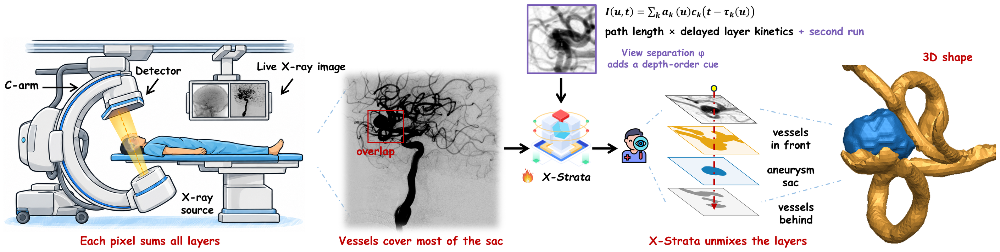
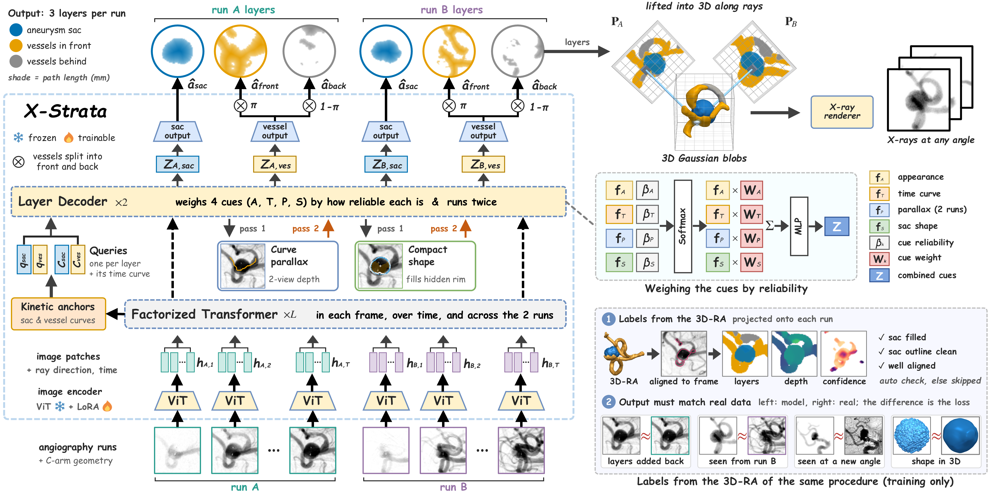
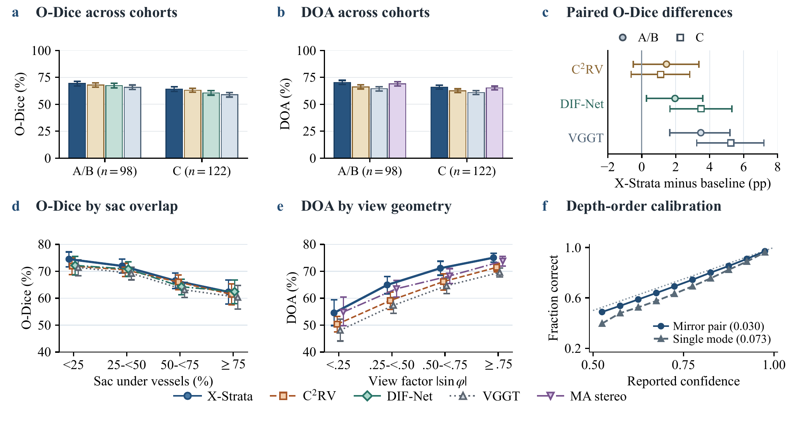

# X-Strata

**Separating Aneurysms and Overlapping Vessels into Layers from 2D X-ray Angiography**

digital subtraction angiography · intracranial aneurysm · amodal layers · depth order · 3D sac shape

  

<b>Layer separation in X-ray angiography.</b> Each log-subtracted pixel integrates contrast attenuation along a ray. Left: the C-arm acquisition setup. Center: sac–vessel overlap on a peak digital subtraction angiography frame. Right: the target layers, which comprise the amodal sac and the vessels in front of and behind it. Parallax between the two views provides a cue to their depth order.

## Overview

An X-ray angiogram sums every structure along a ray into one pixel. When vessels cross an intracranial aneurysm, they obscure part of the sac and mix their contrast into its filling curve. 3D rotational angiography (3D-RA) can resolve the overlap, but not every patient undergoes it.

X-Strata separates a 2D cine angiogram into three layers: the complete (amodal) aneurysm sac, the vessels in front of it, and the vessels behind it. Each cue is used for what it measures. Contrast timing indicates how much each layer contributes to a pixel. Parallax between two views indicates the order of the layers, which a single view cannot determine.

<table align="center">
  <tr align="center">
    <th>Input at inference</th><th>Output per run</th><th>Training labels</th><th>Evaluation</th>
  </tr>
  <tr align="center">
    <td>2D cine runs + C-arm geometry</td>
    <td>Sac · front vessels · back vessels path lengths · contrast curves depth order · 3D layers</td>
    <td>Projected from same-session 3D-RA (training only)</td>
    <td>220 held-out patients 3 centers · 122 external</td>
  </tr>
</table>

## Method

  

<b>Two-pass architecture of X-Strata.</b> A ray-aware encoder processes cine frames and their C-arm geometry. Kinetic anchors initialize the layer time curves. The first-pass maps provide vessel centerlines and the visible sac rim for estimating parallax and shape cues. The second pass weights appearance, time, parallax, and shape to estimate layer path lengths and front-vessel probabilities. The layer maps are lifted into a shared 3D Gaussian representation for rendering. During training, projected labels from same-session 3D-RA supervise eligible pre-deployment runs.

1. **First pass.** The network estimates the three layer maps and their contrast curves from each cine run.
2. **Second pass.** Vessel depth is searched along centerlines in the second view, and the visible sac rim constrains the hidden part of the sac. A layer decoder weighs appearance, time, parallax, and shape by how reliable each cue is.
3. **3D lifting.** All layers are lifted into a shared 3D representation that an X-ray renderer can project to any angle.

## Results

X-Strata is evaluated on 220 held-out patients: 98 internal-test patients from Centers A and B and 122 external-test patients from Center C.

- With two runs, X-Strata ranks first among 14 baselines, including VGGT and C2RV, in recovering the sac where vessels overlap it (O-Dice 0.693 internal, 0.641 external) and in ordering the layers (DOA 0.703, 0.659).
- Its order accuracy exceeds that of all 11 end-to-end baselines by at least 4.1 points internally and 3.3 points externally (Holm-adjusted *p* < 0.001) and grows with view separation.
- Recovered 3D sac surfaces have a median Chamfer distance of 0.34 mm on the internal cohort.

### Amodal layer decomposition across cohorts

<table>
<thead>
<tr><th rowspan="2" align="left">Method</th><th rowspan="2">Cues</th><th colspan="5">Internal test Centers A and B (n = 98)</th><th colspan="2">External test Center C (n = 122)</th></tr>
<tr><th>Sac Dice &uarr;</th><th>O-Dice &uarr;</th><th>Vessel Dice &uarr;</th><th>DOA &uarr;</th><th>MAE (mm) &darr;</th><th>O-Dice &uarr;</th><th>DOA &uarr;</th></tr>
</thead>
<tbody>
<tr><td colspan="9"><b>One input run</b></td></tr>
<tr><td>nnU-Net 2D+t</td><td align="center"><code>A T &middot; &middot; &middot;</code></td><td align="right"><ins>.699</ins></td><td align="right"><ins>.607</ins></td><td align="right">.692</td><td align="right">&ndash;</td><td align="right">&ndash;</td><td align="right">.533</td><td align="right">&ndash;</td></tr>
<tr><td>SAM 2</td><td align="center"><code>A T &middot; &middot; &middot;</code></td><td align="right">.692</td><td align="right">.598</td><td align="right">.687</td><td align="right">&ndash;</td><td align="right">&ndash;</td><td align="right"><b>.569</b></td><td align="right">&ndash;</td></tr>
<tr><td>SAM 3</td><td align="center"><code>A T &middot; &middot; &middot;</code></td><td align="right">.688</td><td align="right">.595</td><td align="right">.682</td><td align="right">&ndash;</td><td align="right">&ndash;</td><td align="right">.546</td><td align="right">&ndash;</td></tr>
<tr><td>Diffusion-VAS</td><td align="center"><code>A T &middot; &middot; &middot;</code></td><td align="right">.691</td><td align="right">.598</td><td align="right"><ins>.696</ins></td><td align="right">&ndash;</td><td align="right">&ndash;</td><td align="right">.536</td><td align="right">&ndash;</td></tr>
<tr><td>Depth Anything V2 + 2 layers</td><td align="center"><code>A &middot; &middot; &middot; &middot;</code></td><td align="right">.654</td><td align="right">.561</td><td align="right">.685</td><td align="right"><ins>.501</ins></td><td align="right"><ins>5.57</ins></td><td align="right">.529</td><td align="right"><b>.517</b></td></tr>
<tr><td>Ellipse (visible sac)&dagger;</td><td align="center"><code>A &middot; &middot; &middot; S</code></td><td align="right">.676</td><td align="right">.579</td><td align="right">&ndash;</td><td align="right">&ndash;</td><td align="right">&ndash;</td><td align="right"><ins>.559</ins></td><td align="right">&ndash;</td></tr>
<tr><td><b>X-Strata</b></td><td align="center"><code>A T &middot; X S</code></td><td align="right"><b>.783</b></td><td align="right"><b>.641</b></td><td align="right"><b>.716</b></td><td align="right"><b>.528</b></td><td align="right"><b>5.20</b></td><td align="right">.552</td><td align="right"><ins>.496</ins></td></tr>
<tr><td colspan="9"><b>Two input runs</b></td></tr>
<tr><td>VGGT</td><td align="center"><code>A &middot; P &middot; &middot;</code></td><td align="right">.744</td><td align="right">.659</td><td align="right"><ins>.694</ins></td><td align="right">.644</td><td align="right">4.63</td><td align="right">.589</td><td align="right">.609</td></tr>
<tr><td>Epipolar transformer</td><td align="center"><code>A T P &middot; &middot;</code></td><td align="right">.748</td><td align="right">.655</td><td align="right">.679</td><td align="right">.648</td><td align="right">4.50</td><td align="right">.595</td><td align="right">.614</td></tr>
<tr><td>DIF-Net &rarr; project</td><td align="center"><code>A &middot; P X &middot;</code></td><td align="right">.765</td><td align="right">.674</td><td align="right">.690</td><td align="right">.651</td><td align="right">4.33</td><td align="right">.606</td><td align="right">.623</td></tr>
<tr><td>C2RV &rarr; project</td><td align="center"><code>A &middot; P X &middot;</code></td><td align="right"><ins>.767</ins></td><td align="right"><ins>.679</ins></td><td align="right">.693</td><td align="right">.662</td><td align="right"><ins>4.14</ins></td><td align="right"><ins>.630</ins></td><td align="right">.626</td></tr>
<tr><td>Ellipsoid (2 runs)&dagger;</td><td align="center"><code>A &middot; P &middot; S</code></td><td align="right">.665</td><td align="right">.577</td><td align="right">&ndash;</td><td align="right">&ndash;</td><td align="right">&ndash;</td><td align="right">.519</td><td align="right">&ndash;</td></tr>
<tr><td>Centerline stereo&dagger;</td><td align="center"><code>A &middot; P &middot; &middot;</code></td><td align="right">&ndash;</td><td align="right">&ndash;</td><td align="right">&ndash;</td><td align="right">.680</td><td align="right">4.43</td><td align="right">&ndash;</td><td align="right">.637</td></tr>
<tr><td>Moment-anchored centerline stereo&dagger;</td><td align="center"><code>A &middot; P X &middot;</code></td><td align="right">&ndash;</td><td align="right">&ndash;</td><td align="right">&ndash;</td><td align="right"><ins>.691</ins></td><td align="right">4.30</td><td align="right">&ndash;</td><td align="right"><ins>.652</ins></td></tr>
<tr><td><b>X-Strata</b></td><td align="center"><code>A T P X S</code></td><td align="right"><b>.807</b></td><td align="right"><b>.693</b></td><td align="right"><b>.700</b></td><td align="right"><b>.703</b></td><td align="right"><b>3.21</b></td><td align="right"><b>.641</b></td><td align="right"><b>.659</b></td></tr>
<tr><td colspan="9"><b>All available input runs</b></td></tr>
<tr><td>X-Strata</td><td align="center"><code>A T P X S</code></td><td align="right">.810</td><td align="right">.700</td><td align="right">.700</td><td align="right">.707</td><td align="right">3.17</td><td align="right">.655</td><td align="right">.668</td></tr>
</tbody>
</table>

O-Dice: sac Dice restricted to a two-pixel dilation of the reference vessel mask. DOA: balanced accuracy of the front and behind classes in the overlap region. MAE: absolute vessel-depth error. Cues: A appearance, T time, P parallax, X transmission physics, S explicit shape. &dagger; Training-free solver using nnU-Net masks. Patients receive equal weight after averaging runs and seeds. <b>Bold</b> and <ins>underline</ins> mark the best and next distinct values within each input budget. Dashes indicate ineligible endpoints.

### Two-run comparisons

  

(a, b) Cohort means for O-Dice and DOA. (c) Patient-paired O-Dice differences for X-Strata against projected C2RV, projected DIF-Net, and VGGT. (d, e) Internal O-Dice by sac overlap and DOA by the view factor |sin φ|. Whiskers in (a–e) give pointwise 95% intervals from 3,000 patient bootstrap draws. (f) Reliability curves pool eligible overlap pixels across seeds; parentheses give the mean per-seed expected calibration error.

### Two-run ablations (internal cohort)

<table>
<thead>
<tr><th align="left">Variant</th><th>O-Dice &uarr;</th><th>DOA &uarr;</th><th>ECE &darr;</th><th>CD (mm) &darr;</th><th>TTP (s) &darr;</th></tr>
</thead>
<tbody>
<tr><td><b>Full model (2 runs)</b></td><td align="right">.693</td><td align="right">.703</td><td align="right">.030</td><td align="right">0.34</td><td align="right">0.144</td></tr>
<tr><td colspan="6"><i>Depth ordering</i></td></tr>
<tr><td>Attention-only parallax</td><td align="right">&ndash;</td><td align="right">.682</td><td align="right">.052</td><td align="right">&ndash;</td><td align="right">&ndash;</td></tr>
<tr><td>Centerline parallax, frozen masks</td><td align="right">&ndash;</td><td align="right">.694</td><td align="right">.050</td><td align="right">&ndash;</td><td align="right">&ndash;</td></tr>
<tr><td>Without moment anchor</td><td align="right">&ndash;</td><td align="right">.704</td><td align="right">.047</td><td align="right">&ndash;</td><td align="right">&ndash;</td></tr>
<tr><td>With ordering constraint</td><td align="right">&ndash;</td><td align="right">.674</td><td align="right">.054</td><td align="right">&ndash;</td><td align="right">&ndash;</td></tr>
<tr><td>Single depth mode</td><td align="right">&ndash;</td><td align="right">.710</td><td align="right">.073</td><td align="right">&ndash;</td><td align="right">&ndash;</td></tr>
<tr><td colspan="6"><i>Shape, cues and temporal supervision</i></td></tr>
<tr><td>Without shape head</td><td align="right">.693</td><td align="right">.710</td><td align="right">.047</td><td align="right">0.35</td><td align="right">0.127</td></tr>
<tr><td>Without identifiability bias</td><td align="right">.693</td><td align="right">.704</td><td align="right">.047</td><td align="right">0.39</td><td align="right">0.146</td></tr>
<tr><td>Without kinetic anchors</td><td align="right">.691</td><td align="right">.698</td><td align="right">.049</td><td align="right">0.36</td><td align="right">0.148</td></tr>
<tr><td>Equal cue weights</td><td align="right">.679</td><td align="right">.696</td><td align="right">.049</td><td align="right">0.42</td><td align="right">0.142</td></tr>
<tr><td>Without temporal gate</td><td align="right">.689</td><td align="right">.695</td><td align="right">.049</td><td align="right">0.35</td><td align="right">0.143</td></tr>
<tr><td colspan="6"><i>3D output and registration</i></td></tr>
<tr><td>Without 3D lifting</td><td align="right">.674</td><td align="right">.696</td><td align="right">.049</td><td align="right">&ndash;</td><td align="right">0.151</td></tr>
<tr><td>Labels from raw DICOM poses</td><td align="right">.624</td><td align="right">.668</td><td align="right">.055</td><td align="right">0.47</td><td align="right">0.212</td></tr>
</tbody>
</table>

Depth-only rows report DOA and expected calibration error (ECE). CD is the median sac Chamfer distance. TTP is the patient-averaged absolute time-to-peak error on the mixture endpoint. Dashes indicate ineligible endpoints.

## Release status

The paper is under review. This repository currently provides the project overview, figures, and main results. Code and trained weights will be released after publication. No patient data are included.

## Collaboration

Developed in collaboration with PLA General Hospital and the PLA Air Force Medical Center.

## Copyright

© 2026 the X-Strata authors. All rights reserved. The text, figures, and tables in this repository may not be reused without permission.
